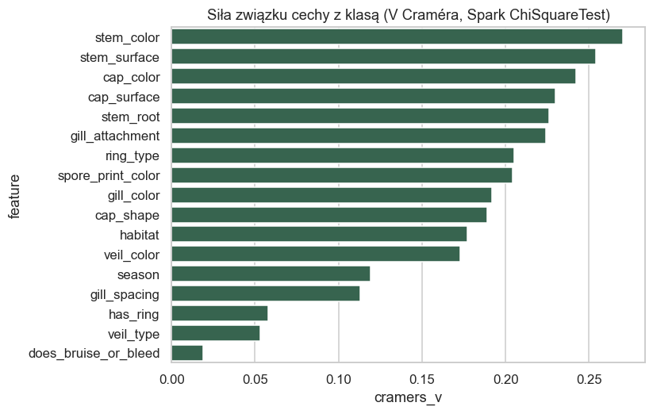
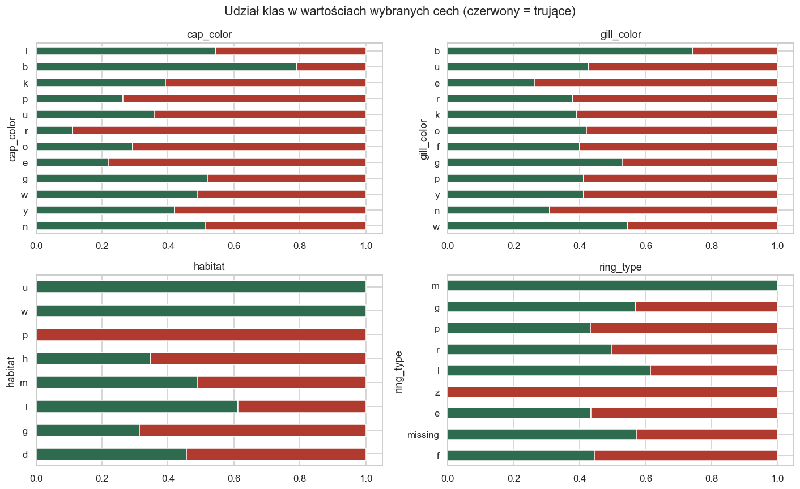
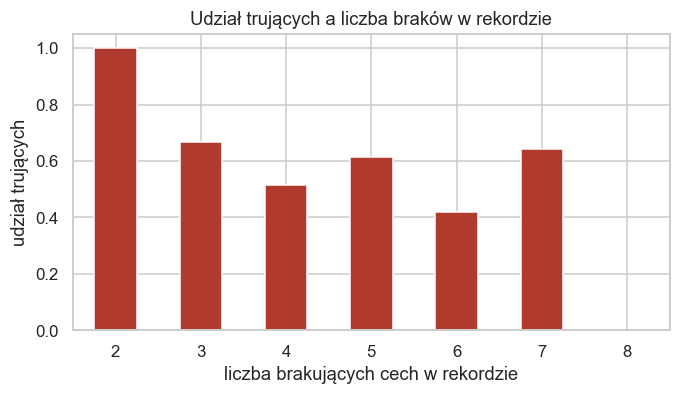
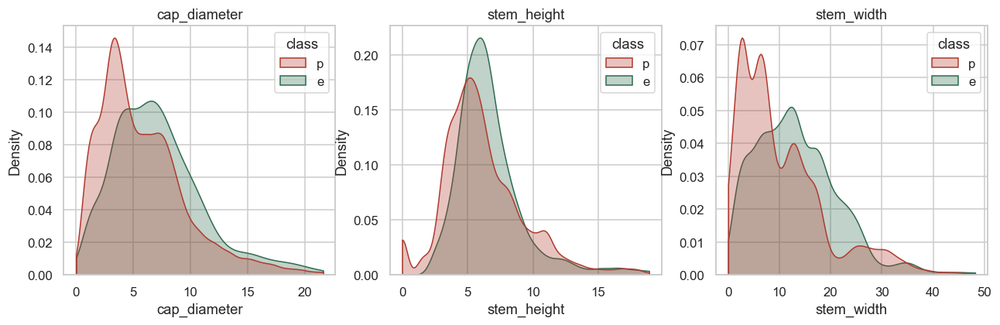
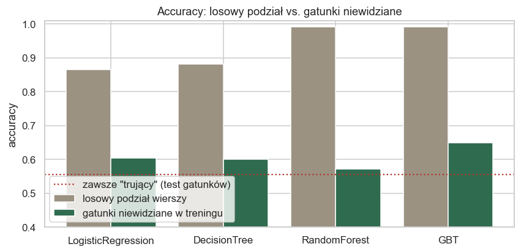
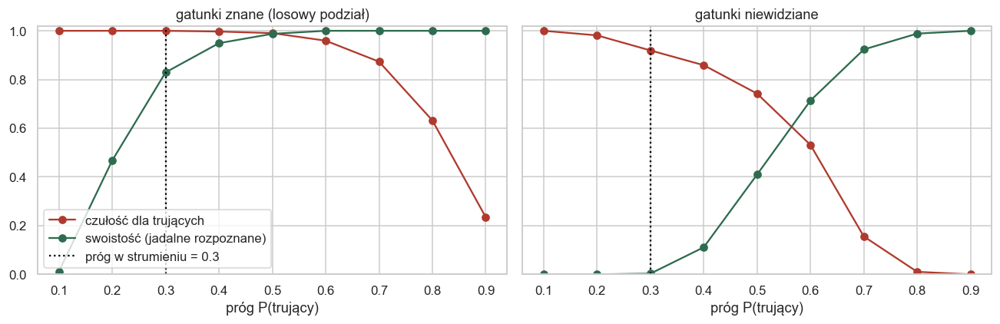

# Sprawozdanie - projekt Big Data

**Temat:** Czy da się rozpoznać, że grzyb jest trujący? Klasyfikacja grzybów w Apache Spark z danymi przesyłanymi przez Apache Kafka

**Dane:** Secondary Mushroom Dataset z UCI Machine Learning Repository (id 848) [1]

Kod projektu jest w katalogu `mushroom_project`, a instrukcja uruchomienia w `README.md`.

---

## 1. Cel projektu i założenia

### 1.1. Cel

W Polsce co roku zdarzają się zatrucia grzybami, a wiele osób ocenia grzyby "na oko" (kolor, pierścień, kształt). 
Chcieliśmy sprawdzić, czy model uczenia maszynowego potrafi na podstawie takich prostych cech odróżnić grzyby jadalne 
od trujących. Drugim celem było zbudowanie małego systemu Big Data, w którym obserwacje grzybów przychodzą jako strumień 
przez Kafkę, a Spark na bieżąco je ocenia.

### 1.2. Tezy

- **H1:** Modele będą bardzo dokładne (> 95%) dla gatunków, które były w danych treningowych, ale dla nowych gatunków 
ich jakość mocno spadnie.
- **H2:** Nie ma jednej prostej reguły (np. "biały grzyb jest jadalny"), która pozwala bezpiecznie uznać grzyb za 
jadalny.
- **H3:** Obniżając próg decyzyjny, da się wyłapać wszystkie trujące grzyby i nadal rozpoznawać większość jadalnych. 
Uznanie jadalnego grzyba za trujący kosztuje najwyżej wyrzucony grzyb, a odwrotny błąd może skończyć się zatruciem, 
więc wolimy mieć więcej fałszywych alarmów niż wyższą trafność.

### 1.3. Wykorzystane metody i narzędzia

- **EDA** w Jupyterze (`notebooks/01_eda.ipynb`): pandas, wykresy seaborn, test χ² i test U Manna-Whitneya (scipy). 
- **ETL** w Apache Spark (`etl.py`): wczytanie CSV, czyszczenie, zapis do Parquet.
- **Szukanie zależności** w Spark (`analysis.py`): test χ² z współczynnikiem V Craméra, reguły asocjacyjne FP-Growth.
- **Uczenie maszynowe** w Spark MLlib (`train.py`): 4 modele, strojenie z walidacją krzyżową.
- **Strumień**: Apache Kafka + Spark Structured Streaming (`producer.py`, `stream_job.py`).
- **Backend i frontend**: FastAPI (`src/mushroom/web/backend.py`) i prosta strona HTML/JS (`frontend/`).
- **Środowisko**: PyCharm, Docker Compose (Kafka, Spark master i worker, backend).

---

## 2. Dobór danych

### 2.1. Skąd

Dataset Secondary Mushroom Dataset [1], to nowsza wersja datasetu "Mushroom". Stary zbiór był zbyt mały aby dawać sensowne wyniki.

Skrypt `etl.py` sam pobiera dane z UCI, jeśli nie ma ich jeszcze na dysku. Można je też pobrać biblioteką `ucimlrepo`:

```python
from ucimlrepo import fetch_ucirepo
secondary_mushroom = fetch_ucirepo(id=848)
```

### 2.2. Struktura i format

Korzystamy z pliku `secondary_data.csv` (CSV, separator `;`) i jego opisu w `secondary_data_meta.txt`. Plik ma 61 069 wierszy, każdy to jeden "grzyb": klasa (`e` jadalny, `p` trujący), 3 cechy liczbowe (średnica kapelusza, wysokość i szerokość trzonu) i 17 cech kategorycznych zapisanych jednoliterowymi kodami (kształt, kolor i powierzchnia kapelusza, blaszki, trzon, pierścień, siedlisko, pora roku itd.).

### 2.3. Charakter danych

- Ilościowo: 61 069 rekordów i 21 kolumn (ok. 3 MB). Trujących jest ok. 55%, jadalnych ok. 45%.
- Jakościowo: 3 cechy są liczbowe, 17 kategorycznych. W danych jest 146 duplikatów, a 9 cech ma braki (od 4% do 95% wartości).
- Grzyby "o nieznanej jadalności" autorzy zbioru wliczyli do trujących.

### 2.4. Dane pierwotne czy wtórne

To dane wtórne. Według opisu zbioru na UCI [1] autorzy przepisali opisy 173 gatunków z atlasu grzybów, a potem wygenerowali z nich `secondary_data.csv`: dla każdego gatunku wylosowali 353 grzyby.

Wiersze w pliku są ułożone gatunkami, po 353 pod rząd: w każdym bloku 353 wierszy jest tylko jedna klasa, a rekordy w bloku są do siebie dużo bardziej podobne niż rekordy z różnych bloków. Dzięki temu dla każdego wiersza wiemy, z jakiego gatunku pochodzi, i możemy testować modele na gatunkach, których nie widziały (punkt 3.4).

### 2.5. Dynamika zmian

Sam zbiór jest statyczny (pobrany raz). W prawdziwym systemie dane treningowe zmieniałyby się rzadko, natomiast zgłoszenia znalezionych grzybów przychodziłyby cały czas, najwięcej latem i jesienią. Dlatego trening robimy wsadowo, a nowe zgłoszenia oceniamy w strumieniu.

### 2.6. Strumień danych przez Kafkę

Nie mamy prawdziwych zgłoszeń, więc je symulujemy:

```
producer.py / formularz na stronie
        │
        ▼
Kafka: mushroom-observations
        │
        ▼
Spark Structured Streaming (stream_job.py) + zapisany model
        │                                  │
        ▼                                  ▼
Kafka: mushroom-predictions        konsola: liczba decyzji na minutę
        │
        ▼
FastAPI ──► strona WWW
```

1. `producer.py` losuje wiersze z `secondary_data.csv` i wysyła je do tematu `mushroom-observations` jako JSON (identyfikator, prawdziwa klasa i 20 cech).
2. `stream_job.py` czyta ten temat w Spark Structured Streaming, czyści dane tą samą funkcją co ETL, liczy prawdopodobieństwo, że grzyb jest trujący, i zapisuje wynik do tematu `mushroom-predictions`. Dodatkowo co minutę wypisuje, ile było decyzji "nie jeść" i "prawdopodobnie jadalny" (okno czasowe).
3. Backend w FastAPI czyta `mushroom-predictions` i pokazuje ostatnie wyniki na stronie. Na stronie jest też formularz, którym można wysłać własny grzyb; trafia on do Kafki, przechodzi przez Sparka i wynik wraca na stronę.

Kafka działa w Dockerze w trybie KRaft (bez ZooKeepera), z jednym brokerem.

---

## 3. Ekstrakcja i analiza danych

### 3.1. Czyszczenie i przekształcenie danych

Najpierw zrobiliśmy EDA w notatniku `01_eda.ipynb`. Wynikło z niej kilka decyzji:

- braki danych zależą od klasy, więc ich nie usuwamy, tylko zamieniamy na osobną wartość `missing`,
- wiersze są ułożone gatunkami, więc dopisujemy do każdego wiersza numer gatunku,
- usuwamy 146 duplikatów.

Skrypt ETL (`src/mushroom/batch/etl.py`) w Sparku:

1. wczytuje plik CSV i zamienia nazwy kolumn na `snake_case` (`cap-diameter` → `cap_diameter`),
2. numeruje wiersze (`zipWithIndex`) i liczy numer gatunku jako `numer_wiersza / 353`,
3. zamienia wymiary na liczby, ujednolica kody i wpisuje `missing` w miejsce braków,
4. dodaje kolumnę `label` (1 = trujący) i usuwa duplikaty,
5. zapisuje wynik do `data/processed/mushrooms.parquet` (podział na katalogi wg klasy).

Po ETL zostaje 60 923 rekordów.

### 3.2. Szukanie ukrytych zależności

Skrypt `src/mushroom/batch/analysis.py` (Spark) zapisuje wyniki do `reports/analysis.json`, a wykresy są w notatniku `02_wyniki.ipynb`.

**Test χ² i V Craméra.** Każda z 17 cech kategorycznych jest statystycznie powiązana z klasą, ale związek jest słaby. Najsilniejsze cechy to kolor trzonu (V = 0,27), powierzchnia trzonu (0,25) i kolor kapelusza (0,24), a najsłabsza to siniaczenie (0,02).



**Proste reguły (EDA).** Sprawdziliśmy każdą wartość każdej cechy. Żadna popularna wartość nie daje nawet 80% grzybów jadalnych (najlepszy jest płowy kapelusz z 79%). Za to niektóre wartości zawsze oznaczają grzyb trujący, np. pierścień strefowy.



**Reguły asocjacyjne FP-Growth.** Każdy grzyb traktujemy jak "koszyk" z elementami typu `kolor_kapelusza=brązowy` i `class=p`. FP-Growth (minimalne wsparcie 3%, ufność 90%) znalazł 6 reguł, które w 100% wskazują grzyb trujący, np. `ring_type=z` (pierścień strefowy) albo `cap_shape=b ∧ has_ring=t` (dzwonkowaty kapelusz z pierścieniem). Dla grzybów jadalnych znalazł tylko 3 reguły, a najlepsza ma ufność 96,3%, czyli co 27. grzyb spełniający tę regułę i tak jest trujący. Łatwiej więc znaleźć sygnały ostrzegawcze niż potwierdzić, że grzyb jest bezpieczny (H2).

**Braki danych.** Test χ² pokazał, że braki zależą od klasy (p < 10⁻¹⁵ dla 7 z 9 cech). Np. wszystkie grzyby z dokładnie 2 brakującymi cechami są trujące. Dlatego w ETL brak jest osobną kategorią, a nie usuniętym rekordem.



**Wymiary.** Grzyby trujące są średnio mniejsze (mediana średnicy kapelusza 5,0 cm wobec 6,7 cm). Test U Manna-Whitneya pokazuje istotną różnicę, ale rozkłady bardzo na siebie nachodzą, więc same wymiary nie wystarczą.



### 3.3. Skrypty ETL i formaty danych

| Skrypt | Wejście | Wyjście |
|---|---|---|
| `etl.py` | CSV (pobierany z UCI, jeśli go nie ma) | Parquet |
| `analysis.py` | Parquet | wyniki analizy (JSON) |
| `train.py` | Parquet | zapisany model Spark ML + metryki (JSON) |
| `stream_job.py` | Kafka (JSON) | Kafka (JSON) |

Kod jest w `src/mushroom/`: zadania wsadowe Sparka w `batch/` (`etl.py`, `analysis.py`, `train.py`), strumień w `stream/` (`producer.py`, `stream_job.py`), backend w `web/`, a ustawienia i wspólne funkcje w `config.py` i `common.py`.

Wybraliśmy Parquet, bo jest kolumnowy, skompresowany i ma zapisany schemat (typy kolumn). Wszystkie zadania uruchamiamy w klastrze Spark (master + worker w Dockerze) poleceniem `spark-submit`, np. `.\run.ps1 etl`.

### 3.4. Uczenie maszynowe w Spark

**Przygotowanie cech.** Używamy `Pipeline` ze Spark MLlib: `StringIndexer` zamienia kody na liczby, `OneHotEncoder` robi z nich kolumny 0/1, a `VectorAssembler` łączy je z trzema wymiarami w jeden wektor. Ustawienie `handleInvalid="keep"` sprawia, że nieznana wartość (np. z formularza) nie przerywa działania programu.

**Modele.** Porównaliśmy 4 klasyfikatory: regresję logistyczną, drzewo decyzyjne, las losowy (100 drzew) i gradient boosting (GBT).

**Dwa sposoby testowania.** Dzięki numerowi gatunku (punkt 2.4) testujemy modele na dwa sposoby:

1. **losowy podział wierszy 80/20** - zwykłe podejście, ale te same gatunki są wtedy i w treningu, i w teście,
2. **podział po gatunkach** - 36 gatunków (20%) odkładamy na test i model w ogóle ich nie widzi w treningu.

Wyniki (accuracy, AUC):

| Model | Losowy podział: accuracy | AUC | Nowe gatunki: accuracy | AUC |
|---|---|---|---|---|
| Regresja logistyczna | 86,1% | 0,937 | 55,5% | 0,600 |
| Drzewo decyzyjne | 88,5% | 0,969 | 45,1% | 0,425 |
| Las losowy | 98,9% | 0,9996 | **59,5%** | **0,609** |
| GBT | **99,1%** | **0,9998** | 52,0% | 0,519 |

Model, który zawsze mówi "trujący", miałby na zbiorze nowych gatunków 55,6%.



Przy losowym podziale las losowy i GBT są prawie idealne. Przy nowych gatunkach tylko las losowy jest trochę lepszy od zgadywania, a drzewo decyzyjne i GBT wypadają nawet gorzej. Wynik zależy też od tego, które gatunki trafią do testu: przy innym losowaniu 36 gatunków las losowy miał AUC 0,72 zamiast 0,61. Modele uczą się więc rozpoznawać gatunki, które już znają, i nie przenoszą tej wiedzy na nowe (H1).

**Strojenie.** Las losowy stroiliśmy `CrossValidator`em na siatce: liczba drzew {50, 100} × głębokość {8, 12}. Foldy walidacji ułożyliśmy po gatunkach (`foldCol`), żeby każdy gatunek był w całości w jednym foldzie. Wszystkie 4 ustawienia dały AUC 0,66-0,68, więc różnice są niewielkie: z cech jednych gatunków słabo da się przewidzieć jadalność innych. Najlepsze okazało się 100 drzew i głębokość 12, czyli te same ustawienia co w porównaniu. Takiego lasu losowego używamy w strumieniu, bo prawie dorównuje GBT na znanych gatunkach i jest najlepszy na nowych.

**Próg bezpieczeństwa (H3).** Domyślnie model mówi "trujący", gdy prawdopodobieństwo jest ≥ 0,5, czyli maksymalizuje trafność i traktuje oba błędy tak samo. Dla grzybów to zły wybór: jadalny grzyb uznany za trujący najwyżej trafi do kosza, a trujący uznany za jadalny może kogoś otruć. Dlatego w strumieniu obniżyliśmy próg do 0,3 (`SAFETY_THRESHOLD` w `config.py`), godząc się na więcej fałszywych alarmów. Poniżej czułość (jaki procent trujących wyłapujemy) i swoistość (jaki procent jadalnych rozpoznajemy):

| Zbiór testowy | Próg | Czułość (trujące) | Swoistość (jadalne) | Trujące uznane za jadalne |
|---|---|---|---|---|
| znane gatunki | 0,5 | 99,1% | 98,8% | 63 |
| znane gatunki | **0,3** | **100%** | 82,9% | **0** |
| nowe gatunki | 0,5 | 74,2% | 41,0% | 1 820 z 7 060 |
| nowe gatunki | **0,3** | 92,0% | 0,3% | 568 z 7 060 |



Próg 0,3 to najwyższy próg, przy którym na znanych gatunkach model nie przepuszcza ani jednego trującego grzyba, a nadal rozpoznaje 83% jadalnych. Na nowych gatunkach model przy tym samym progu przepuszcza 8% trujących i uznaje za trujące prawie wszystkie jadalne. Żeby wyłapać wszystkie trujące grzyby z nowych gatunków, trzeba zejść do progu 0,1, ale wtedy model uznaje za trujące po prostu wszystko.

Na koniec las losowy jest uczony na wszystkich 60 923 rekordach i zapisywany do `models/best_model`, skąd wczytuje go zadanie strumieniowe.

---

## 4. Wnioski

### 4.1. Tezy

- **H1 - potwierdzona.** Na znanych gatunkach mamy 99% trafności, a na nowych 45-60% (przy 55,6% dla zgadywania).
- **H2 - potwierdzona.** Żadna pojedyncza cecha nie daje pewności, że grzyb jest jadalny. Są za to reguły, które na 100% wskazują grzyb trujący.
- **H3 - potwierdzona tylko dla znanych gatunków.** Przy progu 0,3 model wyłapuje wszystkie trujące grzyby ze znanych gatunków i nadal rozpoznaje 83% jadalnych (trafność spada z 98,9% do 92,4%). Na nowych gatunkach przy tym progu przepuszcza 8% trujących i uznaje za trujące prawie wszystkie jadalne.

### 4.2. Najważniejsze wnioski

1. **Wysoka dokładność może oszukiwać.** Gdybyśmy testowali tylko losowym podziałem, wyszłoby 99% i wniosek, że problem jest rozwiązany. Dopiero test na nowych gatunkach pokazał, że model nie radzi sobie z grzybami, których nie zna. Przy danych pogrupowanych (tu: gatunki) trzeba dzielić dane po grupach.
2. **Strojenie parametrów nie pomogło**, bo w danych brakuje informacji, która pozwalałaby ocenić nowe gatunki.
3. **System może ostrzegać, ale nie powinien "pozwalać".** Łatwo znaleźć cechy grzybów trujących, trudno potwierdzić jadalność. Niski próg zmniejsza ryzyko, ale wtedy system odrzuca też dużo jadalnych grzybów.

### 4.3. Jak to wspiera podejmowanie decyzji

- **Grzybiarz** dostaje szybkie ostrzeżenie "nie jeść". Wynik "prawdopodobnie jadalny" to tylko wskazówka i grzyb i tak trzeba pokazać grzyboznawcy.
- **Punkt konsultacyjny sanepidu** może sortować zgłoszenia według prawdopodobieństwa, że grzyb jest trujący, i sprawdzać najpierw te najgroźniejsze. Reguły z FP-Growth mogą służyć jako lista cech ostrzegawczych.
- **Osoby utrzymujące system** widzą w strumieniu, ile jest ostrzeżeń, i porównują decyzje z prawdziwą klasą. Spadek trafności oznaczałby, że pojawiają się gatunki spoza bazy i trzeba douczyć model.

### 4.4. Ograniczenia

- Dane są wygenerowane z opisów gatunków [1], a nie zmierzone na prawdziwych grzybach.
- Zbiór ma tylko 173 gatunki, a w Polsce rośnie ich kilka tysięcy, więc w praktyce większość grzybów byłaby dla modelu "nowa".
- Kafka i Spark działają na jednym komputerze w Dockerze, więc nie mierzyliśmy wydajności.

---

## 5. Źródła

1. Secondary Mushroom Dataset, UCI Machine Learning Repository. https://archive.ics.uci.edu/dataset/848/secondary+mushroom+dataset
2. Dokumentacja Apache Spark 3.5 (MLlib, Structured Streaming + Kafka). https://spark.apache.org/docs/3.5.5/
3. Dokumentacja Apache Kafka. https://kafka.apache.org/documentation/
4. Dokumentacja FastAPI. https://fastapi.tiangolo.com/
